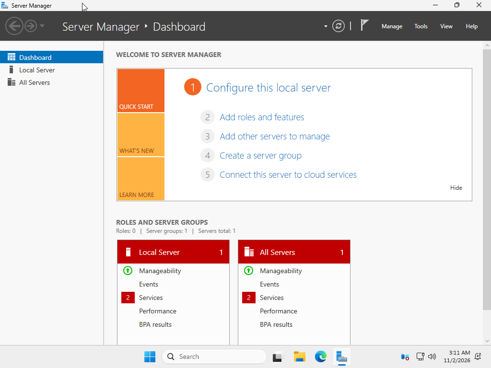

# Windows Server 2025 — Active Directory Domain Controller Lab

**Project Status:** In Progress — DNS troubleshooting and final validation pending

## 1. Project Overview

This project documents the deployment and configuration of a Windows Server 2025 domain controller in a virtualized lab environment using Oracle VirtualBox.

The lab simulates a small business IT infrastructure for a fictional company named Caribbean Technology Solutions (CTS).

The purpose of this project is to develop hands-on experience in Windows Server administration, Active Directory Domain Services (AD DS), DNS, network configuration, and infrastructure troubleshooting.

## 2. Technologies Used

- Windows Server 2025 Standard Evaluation
- Oracle VirtualBox
- Active Directory Domain Services (AD DS)
- Windows DNS Server
- Windows PowerShell
- Windows Server Manager
- Windows Event Viewer

## 3. Virtual Lab Configuration

| Component | Configuration |
|---|---|
| Virtual machine | SERVER01 |
| Operating system | Windows Server 2025 Standard Evaluation |
| Memory | 4 GB RAM |
| Processors | 2 virtual CPUs |
| Virtual storage | 80 GB dynamically allocated |
| Domain | cts.test |
| NetBIOS name | CTS |
| Domain controller | SERVER01 |
| NAT IP address | 10.0.2.15 |
| Host-only IP address | 192.168.56.10 |
| DNS server | 192.168.56.10 |
### Windows Server 2025 Lab Environment

## 4. Implementation

### Windows Server Installation

**Figure 2:** Windows Server 2025 configured with the computer name SERVER01.
Created a virtual machine in Oracle VirtualBox, attached the Windows Server 2025 installation ISO, and installed the Desktop Experience edition.

### Network Configuration

**Figure 3:** Static IPv4 configuration for the Active Directory lab network.
Configured two virtual network adapters:

- NAT for external connectivity.
- Host-only networking for the private Active Directory lab.

Assigned the host-only interface a static IPv4 address of 192.168.56.10.

### Active Directory Deployment

**Figure 4:** Successful prerequisite checks before promoting SERVER01 to a domain controller.
Installed the Active Directory Domain Services role and promoted SERVER01 to the first domain controller in a new forest named `cts.test`.

### DNS Configuration
### DNS Troubleshooting Investigation

During the configuration of Active Directory Domain Services, I encountered a DNS resolution issue affecting domain controller discovery.

The following troubleshooting steps were performed:

1. Examined DNS Server Event Viewer warnings **4013** and **4017**.
2. Used `dcdiag /test:DNS /v` to examine domain controller DNS configuration.
3. Identified an invalid DNS client configuration reported on the NAT adapter.
4. Updated the DNS client settings to use `192.168.56.10`.
5. Verified that the `_msdcs.cts.test` zone was active and Active Directory-integrated.
6. Successfully resolved the zone's SOA record.
7. Confirmed the LDAP SRV record existed and pointed to `server01.cts.test` on port `389`.

**Current finding:** The LDAP SRV record exists in the DNS zone, but queries for `_ldap._tcp.dc._msdcs.cts.test` continue to return NXDOMAIN.

**Resolution status:** Investigation ongoing.
### DNS Troubleshooting Evidence

**Figure 5: DNS SRV Record Verification**

Verified that Active Directory SRV records were present in the `_msdcs.cts.test` DNS zone.

**Figure 6: LDAP DNS Resolution Failure**

Attempted to resolve `_ldap._tcp.dc._msdcs.cts.test` using PowerShell. The query returned `DNS_ERROR_RCODE_NAME_ERROR`, indicating that the requested DNS name could not be resolved.

**Figure 7: DNS Address Resolution**

Investigated DNS registration and discovered that `SERVER01.cts.test` was returning both the host-only address `192.168.56.10` and the NAT address `10.0.2.15`.

**Figure 8: DNS Resource Record Inspection**

Compared DNS query results with the A records stored in the `cts.test` zone to investigate inconsistent address resolution.

### Troubleshooting Status

The DNS investigation remains open. The `_msdcs.cts.test` zone and its SRV records have been verified, but the LDAP SRV lookup continues to return NXDOMAIN.

The next objective is to identify why the DNS server is not successfully resolving the existing record.
### Lessons From Troubleshooting

This investigation provided practical experience using Windows Event Viewer, PowerShell, DNS Manager, and Microsoft's domain controller diagnostic utility.

It also demonstrated the importance of distinguishing between a DNS record existing in the server's database and that record being successfully resolved through DNS queries.
Configured Windows DNS Server and verified the presence of the `cts.test` and `_msdcs.cts.test` zones.

## 5. Troubleshooting and Diagnostics

Investigated DNS name-resolution problems affecting Active Directory domain-controller discovery.

Diagnostic activities included:

- Reviewing DNS Server Event Viewer warnings 4013 and 4017.
- Running `dcdiag /test:DNS /v`.
- Correcting the DNS client configuration on the NAT network adapter.
- Checking DNS zone status and resource records using PowerShell.
- Successfully resolving the SOA record for `_msdcs.cts.test`.
- Verifying that the LDAP SRV record exists and targets `server01.cts.test` on port 389.

**Outstanding issue:** DNS queries for `_ldap._tcp.dc._msdcs.cts.test` continue to return NXDOMAIN despite the record appearing in the DNS database.

## Skills Demonstrated

Throughout this project, I gained hands-on experience with:

- **Virtualization:** Creating and configuring a Windows Server 2025 virtual machine using Oracle VirtualBox.
- **Windows Server Administration:** Installing Windows Server, renaming the server, and configuring network interfaces.
- **Active Directory Domain Services:** Installing AD DS and promoting SERVER01 to the first domain controller in the `cts.test` forest.
- **DNS Administration:** Examining DNS zones, A records, SOA records, and SRV records.
- **PowerShell:** Running administrative commands to inspect network configurations and troubleshoot DNS.
- **Troubleshooting:** Investigating DNS resolution errors using PowerShell, Event Viewer, DNS Manager, and DCDIAG.
- **Technical Documentation:** Recording configurations, diagnostic results, and troubleshooting findings in GitHub.

## Project Outcomes

### Completed

- Installed Windows Server 2025 Standard Evaluation.
- Configured a virtual server environment with NAT and host-only networking.
- Assigned the static IPv4 address `192.168.56.10` to the host-only adapter.
- Installed Active Directory Domain Services.
- Promoted SERVER01 to a domain controller for `cts.test`.
- Verified the existence of Active Directory-integrated DNS zones.
- Confirmed the presence of domain controller SRV records.
- Documented troubleshooting activities with screenshots.

### Outstanding Issue

DNS queries for `_ldap._tcp.dc._msdcs.cts.test` continue to return NXDOMAIN despite the corresponding SRV record being present in the DNS server's zone data.

The issue remains under investigation and has not been documented as resolved.

## Next Steps

- Continue diagnosing the DNS SRV resolution issue.
- Verify domain controller discovery and Active Directory health.
- Create organizational units (OUs), user accounts, and security groups.
- Configure Group Policy Objects (GPOs).
- Join a Windows client to the domain.
- Configure shared folders and NTFS permissions.

## Project Status

**Project 1: Initial deployment and documentation completed; DNS troubleshooting ongoing.**

**Project 2: Active Directory User, Group, OU, and Group Policy Administration — Planned.**

*This project was completed in a personal virtual lab for educational and professional development purposes.*
